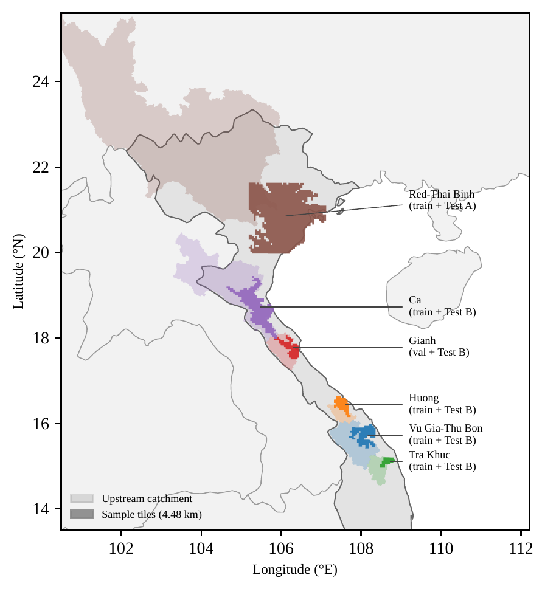
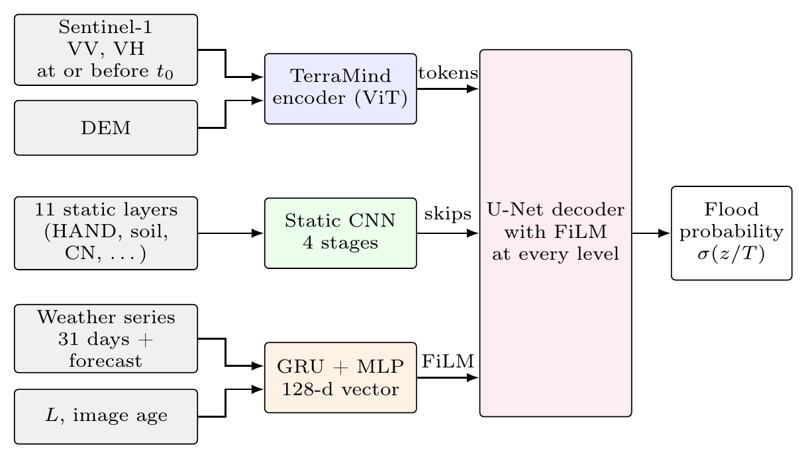
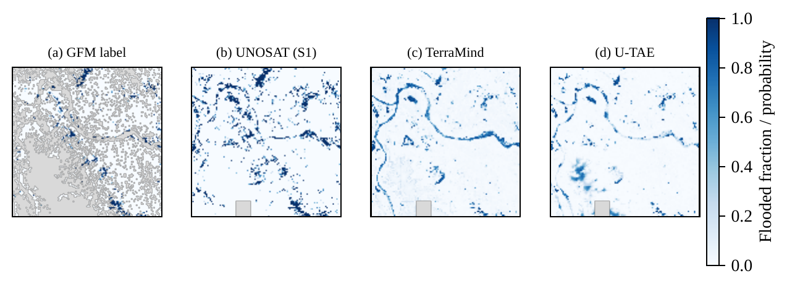

# Vietnam Flood Forecasting

[](https://github.com/mhieuz-dev/vietnam-flood-forecasting/actions/workflows/tests.yml)
[](LICENSE)
[](https://creativecommons.org/licenses/by/4.0/)
[](https://doi.org/10.5281/zenodo.24382480)

Code for the paper

> **Do Geospatial Foundation Models Help Short-Range Flood Inundation Forecasting? An Event-Split Benchmark for Vietnam with Independent Label Checks**
> Minh-Hieu Ho, Trong-Nghia Le, Viet-Nam Nguyen, Thien-Bao Nguyen. University of Economics Ho Chi Minh City (UEH).

The repository builds a benchmark for one- to three-day flood inundation forecasting at 20 m in six river basins of northern and central Vietnam, trains a TerraMind fusion model and five baselines on it, and writes every table of the paper from the evaluation results. The benchmark samples, the trained checkpoints and the model outputs are on Zenodo (see [Data and checkpoints](#data-and-checkpoints)).

## The benchmark in brief

A sample is a 4.48 km tile, a target date *t* and a lead time *L* of 1, 2 or 3 days. The forecast is issued at *t*<sub>0</sub> = *t* - *L* and predicts, for every 20 m pixel, the probability that it is flooded at the Sentinel-1 overpass of day *t*. Labels are the Copernicus Global Flood Monitoring (GFM) flood extent.

<p align="center"></p>

| Split | Events | Basins |
|---|---|---|
| Train | 78 floods, 2016-2023, plus dry rainy-season dates | Red-Thai Binh, Ca, Huong, Vu Gia-Thu Bon, Tra Khuc |
| Validation | 30 floods, 2016-2023 | Gianh (never used for training) |
| Test A | Typhoon Yagi, September 2024 | Red-Thai Binh |
| Test B | Central Vietnam floods, October-November 2025 | the five central basins |
| Leave-one-basin-out | all dates of the held-out basin | each training basin in turn |

The two test sets were fixed with SHA-256 hashes of every label file before any model was trained ([`cau_hinh/tap_test_khoa.json`](cau_hinh/tap_test_khoa.json)). Test data can only be read through one function that appends to [`results/nhat_ky_test.log`](results/nhat_ky_test.log), so every test reading is on record with its commit.

Inputs per sample: the latest Sentinel-1 VV/VH image at or before *t*<sub>0</sub> (never the image of day *t*), its age in days, twelve static layers (Copernicus DEM, slope, HAND, upstream area, SoilGrids clay, sand and bulk density, SCS curve number, ESA WorldCover, JRC permanent water), a 31-day weather series (IMERG Final, ERA5-Land temperature, humidity and soil water, antecedent precipitation index) and the GFS rainfall forecast from *t*<sub>0</sub> to *t*.

## Models

<p align="center"></p>

| Code | Model | Module |
|---|---|---|
| Main | TerraMind 1.0 base (Sentinel-1 + DEM) + static CNN + weather GRU, FiLM decoder | [`floodlab/mo_hinh/hop_nhat.py`](floodlab/mo_hinh/hop_nhat.py) |
| B0 | Historical flood frequency per pixel | [`floodlab/doi_chung.py`](floodlab/doi_chung.py) |
| B1 | HAND and rainfall thresholds | [`floodlab/doi_chung.py`](floodlab/doi_chung.py) |
| B2 | XGBoost on pixel features | [`scripts/chay_doi_chung.py`](scripts/chay_doi_chung.py) |
| B3 | U-Net (ResNet-34, from scratch) | [`floodlab/mo_hinh/unet.py`](floodlab/mo_hinh/unet.py) |
| B4 | Prithvi-EO-2.0 300M on a dry-season Sentinel-2 composite | [`floodlab/mo_hinh/prithvi_b4.py`](floodlab/mo_hinh/prithvi_b4.py) |
| B5 | Two-branch U-TAE as in GFF | [`floodlab/mo_hinh/utae_b5.py`](floodlab/mo_hinh/utae_b5.py) |
| B6 | Persistence of the latest GFM map | [`floodlab/doi_chung.py`](floodlab/doi_chung.py) |

All deep models share the weather branch and the FiLM decoder, use AdamW, batch 16, BCE + Dice loss and early stopping on the Gianh CSI, and were trained with three seeds. Run settings are in [`cau_hinh/thi_nghiem.yaml`](cau_hinh/thi_nghiem.yaml).

## Results

Critical success index at the threshold chosen on the validation basin; deep models give the mean ± standard deviation over three seeds. The full table with Brier score and ECE is `bai_bao/bang/bang2_ket_qua.tex`.

| Model | Test A CSI | Test A CSI (new flooding) | Test B CSI | Test B CSI (new flooding) |
|---|---|---|---|---|
| B0 Flood frequency | 0.085 | 0.054 | 0.118 | 0.087 |
| B1 HAND + rainfall | 0.033 | 0.029 | 0.149 | 0.164 |
| B2 XGBoost | 0.197 | 0.102 | 0.201 | 0.207 |
| B6 Persistence | 0.177 | 0.000 | 0.041 | 0.000 |
| B3 U-Net | 0.222 ± 0.046 | 0.148 ± 0.021 | 0.211 ± 0.018 | 0.206 ± 0.016 |
| B4 Prithvi-EO-2.0 | 0.102 ± 0.027 | 0.094 ± 0.028 | 0.193 ± 0.029 | 0.193 ± 0.037 |
| B5 U-TAE | 0.274 ± 0.008 | 0.153 ± 0.011 | 0.181 ± 0.014 | 0.175 ± 0.016 |
| TerraMind (GFS) | 0.242 ± 0.016 | 0.143 ± 0.020 | 0.174 ± 0.012 | 0.166 ± 0.014 |

No architecture wins both test events. On Yagi, GFM misses about half of the water mapped by UNOSAT and by optical Copernicus EMS maps, so all scores on Test A are measured against an incomplete reference:

<p align="center"></p>
<p align="center"><sub>Red River delta, 12 September 2024, L = 1. (a) GFM label, gray where GFM has no valid observation; (b) UNOSAT water extent from the same Sentinel-1 overpass; (c) TerraMind and (d) U-TAE flood probability.</sub></p>

## Installation

Python 3.11 and [uv](https://docs.astral.sh/uv/) are assumed. The lock file pins the exact versions used for the paper (PyTorch 2.14.1 with CUDA 13).

```bash
git clone https://github.com/mhieuz-dev/vietnam-flood-forecasting.git
cd vietnam-flood-forecasting
uv venv --python 3.11
uv pip install -r requirements.lock.txt
uv run pytest -q          # 142 tests, about one minute on CPU, no data needed
```

## Data and checkpoints

The benchmark is archived on Zenodo: [doi.org/10.5281/zenodo.24382480](https://doi.org/10.5281/zenodo.24382480). Download the files you need and unzip them in the repository root; each archive already contains its target path.

| File | Content | Unzips to | Needed for |
|---|---|---|---|
| `mau_<basin>.zip` (6 files) | sample shards (zarr), sample index (parquet), list of discarded samples with reasons | `data/mau/` | everything |
| `mau_chung.zip` | target dates per basin | `data/mau/ngay_muc_tieu/` | rebuilding shards |
| `nhan.zip` | GFM labels per tile and date, exclusion masks, daily flooded fractions | `data/nhan/` | evaluation (test labels are checked against the SHA-256 lock), B0 |
| `s2_<basin>.zip` | dry-season Sentinel-2 composites (Red-Thai Binh in two parts, `_1` and `_2`) | `data/s2/` | B4 only |
| `doi_chung_b0.zip` | B0 flood-frequency maps | `data/doi_chung/b0/` | B0 |
| `du_bao.zip` | GFS and ECMWF forecast cache | `data/du_bao/` | ECMWF rainfall swap test |
| `checkpoints_<group>.zip` (7 files) | trained weights `checkpoints/<run>/best.pt` of all 44 training runs | `checkpoints/` | evaluation without retraining |
| `ket_qua_tho.zip` | per-tile confusion counts of every evaluation, B2 XGBoost models | `results/raw/` | `scripts/tong_hop.py`, B2 |

`SHA256SUMS.txt` on Zenodo lists the hash of every archive (`sha256sum -c SHA256SUMS.txt`).

**Upstream area.** The static layer `log_dien_tich_thuong_nguon` (channel 4 of `tinh`) was taken from MERIT Hydro, whose license (CC BY-NC 4.0 or ODbL) does not allow it to be redistributed under CC BY 4.0. The shards on Zenodo therefore hold `NaN` in this channel. The checkpoints were trained with it, so restore it before evaluating or retraining (free Earth Engine account and a Google Cloud project with Earth Engine enabled):

```bash
earthengine authenticate
EE_PROJECT=<your-cloud-project> uv run python scripts/them_dien_tich_thuong_nguon.py   # fills the channel in every shard
```

The script downloads MERIT Hydro `upa` on the same 20 m grid of each tile and applies the same transform as `scripts/tai_lop_tinh.py`, `log10(max(upa, 0.01))` stored as float16.

## Reproducing the paper

Every number in the tables and in the text is written by [`scripts/tong_hop.py`](scripts/tong_hop.py) together with the key of the result file it comes from, and `tests/test_tong_hop.py::test_moi_so_trong_bang_co_nguon` checks each value against that file.

```bash
# 1. Rebuild all tables and statistics from the stored evaluation results (CPU, minutes)
uv run python scripts/tong_hop.py

# 2. Evaluate a trained checkpoint on validation (threshold choice), Test A and Test B (GPU)
uv run python scripts/cham_mo_hinh.py --ten hop_nhat_gfs_s0
uv run python scripts/cham_mo_hinh.py --ten hop_nhat_gfs_s0 --nguon ecmwf          # ECMWF instead of GFS rainfall
uv run python scripts/cham_mo_hinh.py --ten hop_nhat_gfs_s0 --kiem_dat hoan_vi     # soil permutation test

# 3. Non-deep baselines B0, B1, B2, B6
uv run python scripts/chay_doi_chung.py --vai_tro val
uv run python scripts/chay_doi_chung.py --vai_tro test_a

# 4. Retrain one run from cau_hinh/thi_nghiem.yaml (an 8 GB GPU is enough)
uv run python scripts/huan_luyen.py hop_nhat_gfs_s0
```

Training ran on two Kaggle T4 GPUs and a laptop RTX 4060 (8 GB). On the laptop, a TerraMind run took 1.0 to 2.4 hours (mean 1.5 hours over 24 runs) and a U-Net run 0.5 to 1.1 hours; the times of every run are in `results/huan_luyen/*.json` (`thoi_gian_giay`).

### Rebuilding the dataset from the original sources

The download scripts need a free Google Earth Engine account (`earthengine authenticate`, then set `EE_PROJECT` to your Google Cloud project with Earth Engine enabled) and a free GFM account (credentials in `.env` as `GFM_USER` and `GFM_PASS`). The order is:

```bash
uv run python scripts/lap_luu_vuc.py                 # catchments (HydroBASINS) and lowland tiles
uv run python scripts/tai_lop_tinh.py --luu_vuc huong   # static layers, per basin
bash scripts/chay_nhan_tat_ca.sh                     # GFM labels, all basins
uv run python scripts/lap_danh_sach_tran.py          # training event list
uv run python scripts/khoa_tap_test.py               # lock the test sets (run once, before any training)
uv run python scripts/tai_khi_tuong.py               # IMERG and ERA5-Land on a 0.1 degree grid
uv run python scripts/tai_khi_tuong.py --gsmap       # GSMaP for the test periods (rainfall swap test)
uv run python scripts/tai_s1.py --luu_vuc huong      # Sentinel-1 ground-state images, per basin
uv run python scripts/tai_gfs.py                     # GFS forecasts for every issue date
uv run python scripts/lap_mau.py                     # assemble the zarr shards
uv run python scripts/tai_s2.py                      # dry-season Sentinel-2 composites (B4 only)
uv run python scripts/tai_ecmwf.py                   # ECMWF open data for the test sets (rainfall swap test)
```

## Repository layout

```
floodlab/          library: grid, inputs, labels, sample assembly, dataset, models, training, evaluation
  mo_hinh/         models (hop_nhat = main TerraMind model, unet = B3, prithvi_b4, utae_b5, film, chung = shared blocks)
scripts/           command-line entry points (download, assemble, train, evaluate, tables)
cau_hinh/          configuration: basins, data sources, events, run list, normalization, locked test sets
results/           evaluation results (json) behind every number in the paper, test access log
bai_bao/bang/      paper tables generated by scripts/tong_hop.py
tests/             142 unit tests
```

Identifiers and comments are in Vietnamese. The most frequent words: *mau* sample, *nhan* label, *tinh* static, *khi_tuong* weather, *du_bao* forecast, *quan_trac* observed, *luu_vuc* basin, *huan_luyen* training, *danh_gia* evaluation, *doi_chung* baseline, *cham* score, *tap* split, *ket_qua* result, *hinh* figure, *bang* table. "Task N" in comments refers to steps of the authors' study protocol.

## Citation

If you use the code or the benchmark, please cite the paper and the dataset. GitHub shows the citation from [`CITATION.cff`](CITATION.cff) under "Cite this repository".

```bibtex
@misc{ho2026vnflood_data,
  author    = {Ho, Minh-Hieu and Le, Trong-Nghia and Nguyen, Viet-Nam and Nguyen, Thien-Bao},
  title     = {Vietnam flood inundation forecasting benchmark: Sentinel-1, GFM labels, rainfall forecasts and trained models for six river basins (2016-2025)},
  year      = {2026},
  publisher = {Zenodo},
  version   = {1.0.0},
  doi       = {10.5281/zenodo.24382480}
}
```

## License

The code is released under the [MIT License](LICENSE). The benchmark on Zenodo is released under [CC BY 4.0](https://creativecommons.org/licenses/by/4.0/) and contains data derived from Copernicus Sentinel-1 and Sentinel-2, Copernicus GFM, Copernicus DEM GLO-30, ESA WorldCover, JRC Global Surface Water, SoilGrids 2.0, ERA5-Land (Copernicus Climate Change Service), NASA GPM IMERG, GSMaP data by the Japan Aerospace Exploration Agency (JAXA), NCEP GFS and ECMWF open data. Please credit these providers when you use the data. The GSMaP-NRT values (test samples only, `quan_trac` source index 1) are derived from JAXA data and remain subject to the [JAXA Terms of Use of Research Data](https://earth.jaxa.jp/en/data/policy/): credit JAXA as the original distributor, and notify JAXA in advance of any commercial use.

## Acknowledgments

We thank the providers of the open data listed above and Kaggle for free GPU time.
